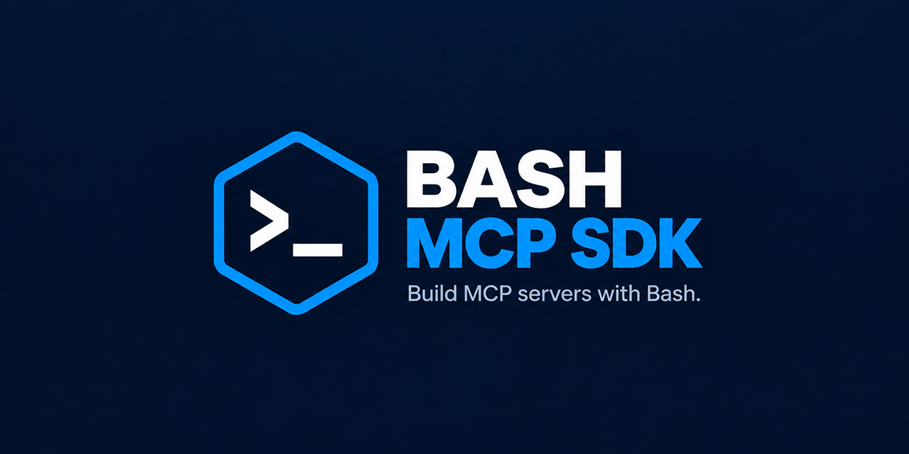

# bash-mcp-sdk

[](https://github.com/shopwareLabs/bash-mcp-sdk/actions/workflows/ci.yml)
[](#-requirements)
[](#-requirements)
[](./LICENSE)

A Bash framework for writing [Model Context Protocol](https://modelcontextprotocol.io) servers. It handles the JSON-RPC 2.0 stdio loop, tool dispatch, argument validation against each tool's `inputSchema`, and logging.

One file, `lib/mcpserver_core.sh`. It sources nothing and needs `jq`, plus `ps` and `mkfifo` for the tool lifecycle. What a server script can rely on and has to do is in [`docs/server-contract.md`](./docs/server-contract.md). The runtime mechanism behind those contracts is in [`docs/architecture.md`](./docs/architecture.md).

## 📌 Requirements

- Bash 4.1+ — the file allocates file descriptors with `{var}` redirection, which arrived in 4.1.
- `jq` 1.7+ — below that floor, jq parses every number to a double. The validator's `integer` check then cannot see a fraction the double rounded away.
- `ps` and `mkfifo` — the tool lifecycle. `run_mcp_server` creates the lifeline with `mkfifo` as it starts, and `ps` is reached only once a tool runs. BusyBox ships both, so an Alpine consumer needs no procps (why the code reads a full `ps` listing is in `docs/architecture.md` §Cancellation).
- `/dev/stdin` — the SDK reads a tool result's text through it. On Linux it is a link into `/proc`.

Sourcing the file checks the first two floors. A Bash below 4.1, a `jq` that is missing or cannot run, or a `jq` below 1.7 is refused on stderr. The refusal names the requirement and, where there is one, the version found. It adds remediation for the platform: its package manager's command where one can be determined, and a generic line otherwise.

> [!NOTE]
> macOS ships Bash 3.2. Install a current Bash (`brew install bash`) or run servers under one. An MCP host launched from the desktop does not read your shell profile. The newer Bash therefore has to sit on the PATH that host starts the server with.

Where to set that `PATH`, and why `ps` and `mkfifo` go unchecked: [Dependencies and PATH](./docs/server-contract.md#dependencies-and-path).

## 📦 Installation

There is no install step. Copy `lib/mcpserver_core.sh` into your project and `source` it. See [Vendoring](#-vendoring) for keeping the copy current.

## 🗜️ API

| Function | Purpose |
|---------------------------|-----------------------------------------------------------------------|
| `run_mcp_server`          | The stdio read loop. Call it last; it returns when stdin closes.      |
| `process_request`         | Parse and route one JSON-RPC line. Useful for testing a server.       |
| `handle_initialize`       | The `initialize` handler `process_request` routes to. Answers `protocolVersion`, `serverInfo` and `capabilities`. |
| `handle_tools_list`       | The `tools/list` handler `process_request` routes to. Answers the `tools` array. |
| `handle_tools_call`       | The `tools/call` handler `process_request` routes to. A consumer can drive it directly to dispatch one call without the read loop. |
| `validate_tool_arguments` | Check a call's arguments against the tool's `inputSchema`. Rejects a tool that the tools list does not declare exactly once with a non-null `inputSchema`, or whose `inputSchema` uses a keyword the validator does not enforce. |
| `create_response`         | Build a JSON-RPC result envelope.                                     |
| `create_error_response`   | Build a JSON-RPC error envelope. Optional 4th arg `data` (JSON value) is included when non-empty. |
| `log`                     | Append to `MCP_LOG_FILE`, and to `MCP_EXTRA_LOG_FILE` when set.       |
| `read_json_file`          | Read one JSON document from a file. Prints it when it is a JSON object; returns 1 on a missing file or one that does not hold exactly one JSON object. |

Configured by environment variable before sourcing:

| Variable | Default | Meaning |
|-----------------------|---------------|---------------------------------------------------------|
| `MCP_TOOLS_LIST_FILE` | `tools.json`  | The tools the server advertises, and their schemas.     |
| `MCP_CONFIG_FILE`     | `config.json` | `protocolVersion`, `serverInfo`, `capabilities`.        |
| `MCP_LOG_FILE`        | `/dev/null`   | Where `log` writes.                                     |
| `MCP_EXTRA_LOG_FILE`  | unset         | Second log target; `PROJECT_ROOT` resolves a relative path. |
| `MCP_LOG_STDERR`      | `0`           | Set to `1` to also mirror each log line to stderr.       |

Defined by the server script and resolved as shell functions only:

| Function | Called |
|---|---|
| `tool_<name>` | For a `tools/call` naming `<name>`, when `tools.json` declares it. Receives the `arguments` JSON. |
| `tool_<name>_cancel` | Optional. When a call of `<name>` is cancelled, or the server shuts down with it in flight. |
| `mcp_before_tool_call` | Optional. Before every dispatched tool, with the tool name and the `arguments` JSON. |

Set by the SDK for a call, not by the consumer:

| Variable | Seen by | Meaning |
|---|---|---|
| `MCP_CALL_TMPDIR` | `mcp_before_tool_call`, the tool function and what it starts, `tool_<name>_cancel` | A directory private to the call, removed when the call ends. See [Per-call files](./docs/server-contract.md#per-call-files). |

Methods handled: `initialize`, `tools/list`, `tools/call` and `ping`; the notifications `notifications/initialized` and `notifications/cancelled`. A request for any other method returns `-32601`; a notification for one is logged and ignored.

How a missing configuration file, an invalid `id` and a malformed line are answered: [Configuration files and protocol handling](./docs/server-contract.md#configuration-files-and-protocol-handling).

### Writing a server

Each tool is a Bash function named `tool_<name>`, receiving the call's `arguments` as one JSON string:

```bash
#!/usr/bin/env bash
set -euo pipefail

HERE="$(cd "$(dirname "${BASH_SOURCE[0]}")" && pwd)"
export MCP_TOOLS_LIST_FILE="${HERE}/tools.json"
export MCP_LOG_FILE="${HERE}/server.log"

source "${HERE}/mcpserver_core.sh"

tool_greet() {
    local args="$1"
    local name
    name=$(printf '%s' "$args" | jq -r '.name')
    printf 'Hello, %s\n' "$name"
}

run_mcp_server
```

The contract a server is written against is in `docs/server-contract.md`:

- [Tool functions](./docs/server-contract.md#tool-functions): which tools dispatch, the enforced `inputSchema` keywords, stdout as the protocol channel, and state across calls.
- [Running a step before every tool](./docs/server-contract.md#running-a-step-before-every-tool): the `mcp_before_tool_call` hook.
- [Per-call files](./docs/server-contract.md#per-call-files): `MCP_CALL_TMPDIR`.
- [Cancelling and shutting down](./docs/server-contract.md#cancelling-and-shutting-down): the cancel hook, the traps `run_mcp_server` installs, and a consumer's `EXIT` handler.

## 🔗 Vendoring

Consumers copy `lib/mcpserver_core.sh` into their own tree and pin the release they copied from. The recommended shape:

1. A lock file recording the tag, e.g. `.mcp-sdk.lock` containing `version=v1.0.0`.
2. A vendor script that downloads that tag and writes the file to every consuming path. A `--check` mode re-vendors to a temp directory and diffs instead of writing.
3. A Renovate custom manager watching the lock file, so upgrades arrive as PRs:

```json
{
  "customManagers": [
    {
      "customType": "regex",
      "managerFilePatterns": ["/^\\.mcp-sdk\\.lock$/"],
      "matchStrings": ["version=(?<currentValue>v\\d+\\.\\d+\\.\\d+)"],
      "depNameTemplate": "shopwareLabs/bash-mcp-sdk",
      "datasourceTemplate": "github-releases",
      "versioningTemplate": "semver"
    }
  ]
}
```

4. A CI job on the Renovate branch. It runs the vendor script, pushes the refreshed file into the same PR, and gates every build on `--check`.

Why step 4 runs in CI rather than in Renovate: [Keeping the vendored copy current](./docs/server-contract.md#keeping-the-vendored-copy-current).

## 🧪 Testing

```bash
./.github/scripts/setup-bats.sh          # once, installs into .bats/
.bats/bats-core/bin/bats -r tests/
```

Or run it in containers, which need Docker:

```bash
./scripts/test-linux.sh            # ShellCheck, then Debian and Alpine
./scripts/test-linux.sh debian     # one distro: no ShellCheck
```

Set `BASE_IMAGE_DEBIAN` or `BASE_IMAGE_ALPINE` to override that build's base image. Set `JQ_VERSION` to install that upstream static jq release instead of the distro package.

Debian is the glibc/GNU run. Alpine adds only Bash and jq to musl/busybox, so a suite that leans on a tool the dev machine happens to carry fails there.

Both suites gate, in bare and named runs alike.

Lint with ShellCheck before pushing:

```bash
find lib tests scripts .github/scripts -type f \( -name '*.sh' -o -name '*.bats' -o -name '*.bash' \) \
  -exec shellcheck --shell=bash --format=gcc {} +
```

## 🚫 Not Supported

- MCP resources and prompts — tools only ([why they are not planned](./docs/server-contract.md#why-resources-and-prompts-are-not-planned))
- Transports other than stdio
- Concurrent request handling; the server loop is strictly sequential
- A request `id`, `method` or tool name larger than the OS command-line argument limit: the request can go unanswered and the server can exit with status 126
- Running the tool command anywhere but the local shell. Container, VM, and remote execution are a consumer concern; this SDK dispatches to a Bash function and nothing more.

## ⚖️ License

[MIT](./LICENSE)
